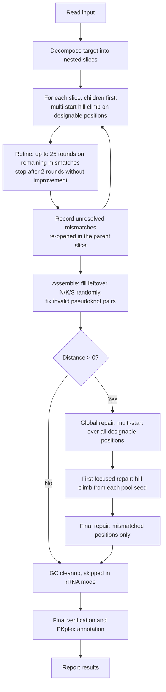
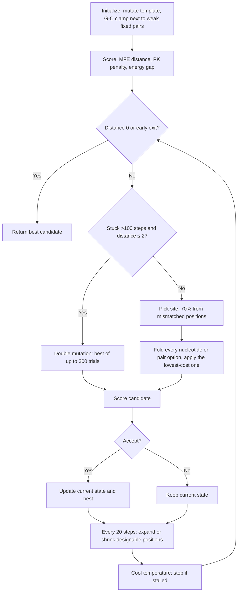

# AROS - Automated RNA Optimization by Slicing

**Team Aarhus University 2026 – Software**
## Table of contents

- [Quick start (TL;DR)](#quick-start-tldr)
- [Overview](#overview)
- [How it works](#how-it-works)
  - [1. Slicing the target](#1-slicing-the-target)
  - [2. Designing a slice](#2-designing-a-slice)
  - [3. Repairing the full sequence](#3-repairing-the-full-sequence)
  - [4. Pseudoknot verification and annotation](#4-pseudoknot-verification-and-annotation)
  - [Supported platforms](#supported-platforms)
- [Installation](#installation)
  - [Requirements](#requirements)
  - [Git LFS (Intel macOS only)](#git-lfs-intel-macos-only)
- [Quick start](#quick-start)
  - [macOS (Intel and Apple Silicon)](#macos-intel-and-apple-silicon)
  - [Linux](#linux)
  - [Windows (MSYS2)](#windows-msys2)
- [Troubleshooting](#troubleshooting)
- [Usage](#usage)
  - [Input and output files](#input-and-output-files)
- [Example](#example)
- [Data and large files](#data-and-large-files)
- [Contributing](#contributing)
  - [Native dependencies](#native-dependencies)
  - [Continuous integration](#continuous-integration)
  - [Project structure](#project-structure)
- [Authors and acknowledgment](#authors-and-acknowledgment)
- [License](#license)
- [Citation](#citation)

## Quick start (TL;DR)

**1. Get the code and run setup** (pick your platform):

| Platform | Before you start | Commands |
|---|---|---|
| **Linux** (x86_64 / arm64) | `sudo apt-get install -y build-essential clang libclang-dev pkg-config git curl` | see below |
| **macOS, Apple Silicon** | `xcode-select --install` | see below |
| **macOS, Intel** | `xcode-select --install` and `brew install git-lfs && git lfs install` (before cloning) | see below |
| **Windows** (x86_64 / ARM64) | Install [MSYS2](https://www.msys2.org/), then open **MSYS2 MinGW x64** (Intel/AMD) or **MSYS2 CLANGARM64** (ARM64). No other terminal works. | see below |

**macOS and Linux:**

```bash
git clone https://gitlab.igem.org/2026/software/aarhus-university/ribologic-rna-sequence-generator.git
cd ribologic-rna-sequence-generator
source ./setup.sh        # use "source", not "./setup.sh"
cargo run --release
```

**Windows (inside the MSYS2 terminal):**

```bash
pacman -S --needed git
git clone https://gitlab.igem.org/2026/software/aarhus-university/ribologic-rna-sequence-generator.git
cd ribologic-rna-sequence-generator
source ./setup.sh

# then run with the target for your CPU:
cargo run --release --target x86_64-pc-windows-gnu        # Intel/AMD
cargo run --release --target aarch64-pc-windows-gnullvm   # ARM64
```

**2. Answer the two prompts.** Press Enter to accept the defaults (3 complete runs, 5 hill-climbing starts per run), or enter your own numbers. More starts use more CPU cores.

**3. Read the result.** Results are written to `misc/output/`, and you can view them in the terminal when asked (y/n). A `bp_distance` of `0` means the sequence folds exactly into your target structure.

**Using your own target:** put a file named `input_<name>.txt` in `misc/` containing a `Sequence:` line and a `Structure:` line of the same length (use `N`, `K`, `S` for positions to design). See [Input and output files](#input-and-output-files).

> The first setup run can take a long time (30+ minutes on Windows ARM64) because it builds ViennaRNA from source. If something fails, see [Troubleshooting](#troubleshooting). For full requirements, see [Installation](#installation).


# Overview

A Rust-based RNA sequence design tool built on the
[ViennaRNA](https://www.tbi.univie.ac.at/RNA/) library. Given a target
RNA secondary structure in dot-bracket notation, it searches for
sequences that fold into that structure. It uses ViennaRNA's
minimum-free-energy (MFE) folding to score candidates, designs the
target slice by slice with parallel multi-start hill climbing, repairs
the assembled sequence globally, and reports the best result.

Team wiki: https://2026.igem.wiki/aarhus-university/

The program supports two sequence-generation modes:

1.  **Generate from ambiguous nucleotides.** Generate sequences from an
    input sequence containing ambiguous RNA nucleotide symbols such as:

    -   `N` --- any nucleotide
    -   `K` --- `G` or `U`
    -   `S` --- `G` or `C`

    Only positions marked `N`, `K` or `S` are designed. All other
    positions are kept as given.

2.  **Generate from a preferred starting sequence.** When
    `const RIBOSOMAL_RNA : bool = true;` is enabled in the program
    configuration, generation begins from the ribosomal large-subunit
    rRNA sequence, or any other query sequence of your choice. Only the
    positions inserted from that sequence are mutated, and known
    conserved motifs are protected.

    The output includes a percentage score indicating how much of the
    original sequence remains in the generated sequence. With this
    method the program takes longer to converge towards the target
    structure, or might not reach it at all (`bp_distance > 0`). GC
    cleanup is skipped in this mode.

Other features:

-   Configurable number of complete runs and parallel starts.
-   Optional scrollable in-terminal viewer for the results, so you don't
    have to open multiple output files to find a candidate.
-   Cross-platform: macOS (Intel and Apple Silicon), Linux, and Windows.

> **Note:** The `Python/` folder and Python script are legacy files and
> are not used by the current program.

## How it works

AROS designs sequences in four stages. It splits the target into
**slices**, designs each slice with a hill-climbing search (children
before parents), repairs the assembled sequence globally, and finally
verifies and annotates pseudoknots.



### 1. Slicing the target

ViennaRNA's MFE algorithm (Zuker) runs in O(n³), so folding one long
sequence over and over is slow. Instead the target is broken into
smaller problems, **slices**.

The target may use only `(`, `)` and `.`, plus one pseudoknot
bracket pair `[` `]`. Other bracket types are rejected.

The target is split into top-level blocks, and each block is split
recursively. A slice is one helix stack (a run of directly stacked base
pairs) together with the unpaired nucleotides at that level: the hairpin
loop, or the bulge, internal-loop and multiloop nucleotides. Nested
stem-loops become their own child slices. Nucleotides between top-level
stems belong to no slice. They are filled randomly after the slice stage
and are only optimized during global repair.

Pseudoknot brackets are removed from slice structures, so pseudoknot
positions are treated as unpaired during slice design. Pseudoknot pairs
are first enforced at the global stage.

Slices are processed one after another in post-order, so children are
designed before their parents. For each slice, only positions that are
ambiguous (`N`, `K`, `S`) in the input are designable. Before a slice is
designed, those positions, plus any mismatches left over from its
children, are reset to `N`. This is how a parent slice repairs the
unresolved parts of its children. Parallelism comes from the independent
hill-climbing starts within a slice (see below), not from running slices
concurrently.

Each slice is designed with `multi_start_hill_climb_design()` using the
full step budget, or 50 steps for slices longer than 150 nucleotides
with fewer than 40 designable positions. The result is then refined for
up to 25 rounds of 50 steps, each restricted to the positions that still
mismatch. Refinement stops early after two rounds without improvement.
Mismatches that survive are recorded and passed on to the parent slice.

The `slices` value in the output is the number of slices the target was
split into.

### 2. Designing a slice

Each slice is passed to `multi_start_hill_climb_design()`, which runs
several independent `hill_climb_design()` searches in parallel (5 by
default). Each search keeps only its single best candidate. The
candidates from all runs are then pooled and sorted by base-pair
distance, with ties broken by MFE.

Each search is a greedy hill climb wrapped in simulated-annealing
acceptance:



#### Initialization

The starting sequence is built by `mutate_seq()`:

- **Pair with a fixed partner:** the complement of the fixed base.
- **`K` / `S` pairs:** `K` becomes G or U and `S` becomes G or C. With
  probability `wobble_frequency`, a G on the 5' side is paired with U.
- **Hairpins with a four-nucleotide loop** (when all six positions are
  designable): a UUCG loop with a G–C closing pair.
- **Pairs adjacent to a loop:** G–C, plus the next two inward pairs if
  they are stacked and designable.
- **All other pairs:** G–C with 80% probability, otherwise A–U. In the
  refinement and repair stages (`last_global`), all pairs start as G–C.
- **Unpaired positions:** uniform over A, U, G and C.

In ribosomal mode, `mutate_ribosome()` is used instead. It changes a
designable pair to G–C with probability 0.2, clamps loop-adjacent pairs
to G–C, switches unpaired positions to A or G with probability 0.2, and
leaves conserved motifs untouched.

The GC bias is deliberate: GC-rich stems fold reliably, and the cleanup
step lowers GC afterwards.

#### Choosing a mutation

Each step picks one designable position. With 70% probability it is
drawn from the positions that currently mismatch the target, otherwise
from all designable positions.

- **Unpaired position:** all four nucleotides are tried.
- **Paired position, partner designable:** all six allowed pair types
  (AU, UA, GC, CG, GU, UG) are tried together.
- **Paired position, partner fixed:** all four nucleotides are scored,
  but if the best option is the one already in place, the base
  complementary to the fixed partner is applied instead.

Every option is folded with ViennaRNA and scored as

```math
\text{cost} = D_{\text{VRNA}} + 2 \times N_{\text{invalid PK pairs}}
```

and the lowest-cost option is applied. If the best option is the one
already in place, a random alternative is applied instead, so the search
never stands still. This step uses the base-pair distance only; the
energy gap is not used here.

**Double mutation.** If the search has not improved for more than 100
steps, the distance is at most 2, and at least 25 steps have passed
since the last double mutation, the search scans pairs of positions (the
mismatched ones if there are at least two, otherwise random designable
ones, capped at 30 positions) and applies the best of at most 300
trials.

**Adapting the designable set.** Every 20 steps, if the distance is at
most 6 and the search has stagnated for 12 steps, the designable set is
expanded around the mismatches. Otherwise, if at least 60 steps have
passed since the last expansion, the set is shrunk toward the mismatches
(down to a minimum of 15 positions).

#### Scoring a candidate

1.  **Strip pseudoknots.** ViennaRNA does not fold pseudoknots directly,
    so `[` and `]` in the target are converted to dots.
2.  **Mask fixed bases.** Fixed bases at positions that are unpaired in
    the target are left untouched.
3.  **Fold.** ViennaRNA computes the MFE structure.
4.  **Measure the distance** to the pseudoknot-stripped target with
    `vrna_bp_distance()`:

```math
D_{\text{VRNA}} = \text{BPDistance}(S_{\text{MFE}},\, S_{\text{target without PK}})
```

Pseudoknot pairs are stored in a pair map and penalized for each pair
that cannot form a valid base pair (this applies from the global stage,
since slice structures contain no pseudoknots):

```math
D_{\text{candidate}} = D_{\text{VRNA}} + 2 \times N_{\text{invalid PK pairs}}
```

A score of `0` means the candidate folds exactly into the target.

#### Energy gap

Two candidates can tie on $D_{\text{candidate}}$ while differing in how
thermodynamically favorable the target fold is for each. The energy gap
measures this:

```math
\Delta E = \max\!\Big(0,\; E(S_{\text{target}} \mid \text{seq}) - E_{\text{MFE}}(\text{seq})\Big)
```

- $E(S_{\text{target}} \mid \text{seq})$ is the free energy of the
  candidate folded into the *target* structure (`vrna_eval_structure`).
- $E_{\text{MFE}}(\text{seq})$ is the free energy of the sequence's true
  MFE structure (`vrna_mfe`).

A gap of `0` means the target is the sequence's MFE fold. The gap is
recomputed every time a candidate is accepted, and it is used only in
the acceptance step below.

#### Accepting candidates

After a mutation, the candidate is scored in full (distance and energy
gap) and then:

- If its distance is **lower**, it is accepted.
- If its distance is **equal**, it is accepted when its gap is smaller
  or equal, and otherwise with probability
```math
  P = \exp\!\left(-\frac{\Delta E_{\text{candidate}} - \Delta E_{\text{current}}}{T}\right)
```
- If its distance is **higher**, it is accepted with probability
```math
  P = \exp\!\left(-\frac{D_{\text{candidate}} - D_{\text{current}}}{T}\right)
```

The temperature falls geometrically from 1 toward 0.01 over the step
budget, with a floor of 0.05, so the search shifts from exploring to
refining.

#### Stopping

A search ends when any of the following happens:

- It has found a candidate with distance 0.
- **Stall:** no improvement for 100 steps (200 steps when the distance
  is at most 6).
- **Early exit:** checked every 50 steps once the distance is at or
  below a threshold that depends on the number of *fixed* positions
  $n_{\text{fixed}}$:

  | Mode | Distance threshold |
  |---|---|
  | Slice | $\lceil n_{\text{fixed}} / 12 \rceil$ |
  | Global, rRNA mode | $\lceil n_{\text{fixed}} / 6 \rceil$ |
  | Global, otherwise | 0 |

  At that point the partition function is evaluated. For every mismatch
  in a position that was originally fixed, the probability of being
  paired is estimated as $1 - \text{defect}$, and the search exits if
  the highest such value is below a threshold:

  | Stage | Pair-probability threshold |
  |---|---|
  | Slice with more than 60% fixed positions, or target with hard loops (non-final) | 0.25 |
  | Other non-final searches | 0.20 |
  | Slice refinement rounds and the focused and final global repairs | 0.10 |

  For slices, the search also exits on the distance criterion alone.

### 3. Repairing the full sequence

**Assembly.** Remaining `N`, `K` and `S` positions are filled randomly.
Any pseudoknot pair in the target that is not a valid Watson–Crick pair
is replaced by a random valid one.

**Global repair.** If the assembled sequence is not at distance 0,
`multi_start_hill_climb_design()` runs over all designable positions for

```math
\text{steps} = \min\!\left(50,\; \max\!\left(1,\; \text{round}\!\left(\tfrac{d_{\text{bp}}}{0.008}\right)\right)\right)
```

steps, where $d_{\text{bp}}$ is the base-pair distance of the assembled
sequence. This equals 50 for any non-zero distance. The pool of results
plus the pre-repair sequence is deduplicated and cut to 16 candidates.
The best is chosen by base-pair distance, then by ensemble diversity
(nested plus pseudoknot). It replaces the original only if its distance
is lower.

**First focused repair.** If the distance is still above 0, each pooled
candidate is refined by a separate `hill_climb_design()` run (up to 50
steps, all pairs initialised as G–C, stricter pair-probability
threshold) over all designable positions. The pool is again
deduplicated, cut to 16 and ranked by distance, then ensemble diversity.

**Final repair.** If the distance is still above 0, each pool sequence
is refined once more, this time restricted to the designable positions
that currently mismatch. Selection is again by distance, then ensemble
diversity.

**GC cleanup.** Unless rRNA mode or `GC_TEST` is on, the sequence passes
through `diversify_sequence()` and then `gc_cleanup()`. Both only touch
base pairs whose two positions were `N` in the input, visit them in
random order, and stop once the GC content lies between the configured
lower and upper thresholds. Every change must keep the base-pair
distance unchanged or lower. `diversify_sequence()` re-draws a random
pair type (A–U, U–A, G–C or C–G). `gc_cleanup()` converts G–C pairs to
A–U or U–A to reduce the GC content, which is typically about 80% before
this step.

### 4. Pseudoknot verification and annotation

Slice design ignores pseudoknots. They enter the cost from the global
stage onward. ViennaRNA's MFE structure contains no pseudoknots, so
`annotate_pk` reinstates the target's pseudoknot pairs wherever the
designed bases can form valid pairs. The reported bp distance is the
pseudoknot-aware distance, with a penalty of 2 per invalid pseudoknot
pair.

ViennaRNA's PKplex is then run as a separate pseudoknot check. Its first
prediction supplies the reported structure and `mfe` value. The result
is therefore **not** a full thermodynamic pseudoknot MFE prediction, and
the reported energy should be read as PKplex's estimate. Ensemble
diversity is reported as the nested plus pseudoknot diversity.


### Supported platforms

`setup.sh` detects your OS/CPU and stages the correct prebuilt (or freshly built) native libraries automatically.

| Platform | Architecture | MSYS2 environment | Status |
|---|---|---|---|
| macOS | Intel (`x86_64-apple-darwin`) | – | Tested manually (not currently in CI) |
| macOS | Apple Silicon (`aarch64-apple-darwin`) | – | Tested in GitHub Actions CI |
| Linux | `x86_64-unknown-linux-gnu` (Ubuntu 22.04 and 24.04) | – | Tested in GitHub Actions CI |
| Linux | `aarch64-unknown-linux-gnu` (Ubuntu 22.04 and 24.04) | – | Tested in GitHub Actions CI (ARM64 runners) |
| Windows | `x86_64-pc-windows-gnu` | MinGW64 | Tested in GitHub Actions CI |
| Windows | `aarch64-pc-windows-gnullvm` | CLANGARM64 | Tested in GitHub Actions CI (ARM64 runner) |
| WSL2 | Treated as Linux | – | Supported by `setup.sh` |

> **Windows x86 (32-bit) is not supported.** MSYS2's 32-bit `MINGW32` repository no longer provides `clang` (needed by Rust `bindgen`) or GSL, so the native libraries cannot be built there.

On macOS and Linux, ViennaRNA is built from source by `setup.sh` if a prebuilt archive is not already present in `vendor/`; GSL, MPFR, and GMP are pulled from your package manager (Homebrew or your Linux distribution's package manager). On Windows, all native libraries (including ViennaRNA) are built from source using MSYS2: GCC in the MinGW64 environment for x86_64, and Clang in the CLANGARM64 environment for ARM64.

## Installation

AROS is built with Cargo and links against static native libraries (ViennaRNA, GMP, MPFR and GSL). `setup.sh` takes care of these for you:

- **Intel macOS:** prebuilt libraries are shipped in `vendor/RNAlib/prebuilt/x86_64-apple-darwin/` and stored with Git LFS.
- **All other platforms:** `setup.sh` builds the static libraries from source (or uses your package manager) and places them in `vendor/RNAlib/prebuilt/<your-target>/`.

Always run it with `source ./setup.sh`, not `./setup.sh`, so Cargo and the native-library environment variables stay available in your shell.

### Requirements

**All platforms**

- Git
- At least 2–3 GB of free disk space for Rust, compilers, packages and native-library builds
- An Internet connection for the first setup run
- **Intel macOS only:** Git LFS, installed **before cloning** (see [Git LFS](#git-lfs-intel-macos-only))

**macOS**

- Xcode Command Line Tools (`xcode-select --install`)
- Homebrew (installed automatically by `setup.sh` if missing)
- Rust (installed automatically by `setup.sh` if missing)

**Linux**

- `x86_64` or `arm64`
- A supported package manager: `apt`, `dnf`, `yum`, `pacman` or `zypper`
- Clang and `libclang` development files (required by Rust `bindgen`), plus a C toolchain and `curl`
- Rust (see the quick start)

On Ubuntu or Debian:

```bash
sudo apt-get update
sudo apt-get install -y build-essential clang libclang-dev pkg-config git curl
```

**Windows**

- Windows 10 or 11 on `x86_64` or `ARM64`
- [MSYS2](https://www.msys2.org/)
- The matching MSYS2 terminal:

  | Your Windows | Terminal | Rust target |
  |---|---|---|
  | x86_64 (Intel/AMD) | **MSYS2 MinGW x64** | `x86_64-pc-windows-gnu` |
  | ARM64 | **MSYS2 CLANGARM64** | `aarch64-pc-windows-gnullvm` |

  Do **not** use PowerShell, Command Prompt, Git Bash, WSL, the plain MSYS2 shell, UCRT64, CLANG64 or MinGW x86 (`MINGW32`). Windows x86 (32-bit) is not supported because MSYS2's `MINGW32` repository no longer provides `clang` or GSL.

`setup.sh` detects the terminal and installs the matching Rust toolchain, compilers, GMP, MPFR and GSL through `pacman`. It then builds ViennaRNA from source. The first run can take a long time, especially on ARM64 (30+ minutes).

### Git LFS (Intel macOS only)

Only the prebuilt Intel macOS libraries are stored with [Git LFS](https://git-lfs.com). If you are on Intel macOS, install it **before cloning**, otherwise you get small pointer files instead of the real libraries and the build fails:

```bash
brew install git-lfs
git lfs install      # once per machine
```

If you already cloned without it, run `git lfs pull` inside the repository. On all other platforms you do not need Git LFS.

## Quick start

### macOS (Intel and Apple Silicon)

```bash
# Intel Macs only, before cloning:
# brew install git-lfs && git lfs install

git clone https://gitlab.igem.org/2026/software/aarhus-university/ribologic-rna-sequence-generator.git
cd ribologic-rna-sequence-generator
source ./setup.sh
cargo run --release
```

`setup.sh` detects your CPU architecture automatically. On Intel Macs, Homebrew has no prebuilt bottles, so it may compile dependencies such as LLVM from source, which can take a long time.

### Linux

Install the [requirements](#requirements) first, then:

```bash
git clone https://gitlab.igem.org/2026/software/aarhus-university/ribologic-rna-sequence-generator.git
cd ribologic-rna-sequence-generator
source ./setup.sh
cargo run --release
```

This works on `x86_64` and `arm64`. `setup.sh` builds ViennaRNA from source and installs Rust if it is missing.

### Windows (MSYS2)

1. Install [MSYS2](https://www.msys2.org/).
2. Open the terminal that matches your CPU (see the table under [Requirements](#requirements)).
3. Install Git if needed:

```bash
   pacman -S --needed git
```
4. Clone and run setup:

```bash
   git clone https://gitlab.igem.org/2026/software/aarhus-university/ribologic-rna-sequence-generator.git
   cd ribologic-rna-sequence-generator
   source ./setup.sh
```
5. Run with the target for your platform:

```bash
   # x86_64 (MSYS2 MinGW x64)
   cargo run --release --target x86_64-pc-windows-gnu

   # ARM64 (MSYS2 CLANGARM64)
   cargo run --release --target aarch64-pc-windows-gnullvm
```

If Rust was not installed automatically on macOS or Linux:

```bash
curl --proto '=https' --tlsv1.2 -sSf https://sh.rustup.rs | sh
source "$HOME/.cargo/env"
```

## Troubleshooting

| Problem | Fix |
|---|---|
| **Intel macOS:** build fails with tiny "pointer" files in `vendor/`, or linker errors about `libRNA.a` | Git LFS did not download the prebuilt libraries. Run `git lfs install && git lfs pull` from the repository root. |
| Linker errors about missing `libRNA.a` on any other platform | The setup step did not finish. Run `source ./setup.sh` again and check for errors. |
| `Unsupported MSYS2 environment` or setup fails on Windows | Use **MSYS2 MinGW x64** (x86_64) or **MSYS2 CLANGARM64** (ARM64). All other shells are unsupported. |
| `cargo: command not found` right after setup | You ran `./setup.sh` instead of `source ./setup.sh`. Source it, or reopen the terminal. |
| `cargo: command not found` on Windows after reopening MSYS2 | Check that Rust is installed, then run `source ./setup.sh` from the correct MSYS2 terminal. |
| `bindgen` cannot find `libclang` | Run `source ./setup.sh` again. On Linux, install `clang` and `libclang-dev`. |
| Setup appears frozen on Windows | It is probably downloading a toolchain or building ViennaRNA (30+ minutes on ARM64). Let `pacman` and `make` finish. |
| `pacman` reports `failed retrieving file` or `Operation too slow` | A mirror stalled. `setup.sh` retries automatically; if it still fails, run it again. |
| `undefined symbol: omp_set_dynamic` or `pthread_mutex_lock` on Windows | The libraries were built by an older setup. Delete `vendor/RNAlib/prebuilt/<your-target>/` and run `source ./setup.sh` again. |
| Setup seems frozen on an Intel Mac | Homebrew may be compiling dependencies such as LLVM from source. This can take a long time. |
| The program uses all CPU cores | Lower the number of hill-climbing starts at the second prompt. |


## Usage

Run this command from the repository root, the directory containing `Cargo.toml`:

```bash
cargo run
```

For an optimized release build:

```bash
cargo run --release
```

On Windows, also pass `--target` for your platform to both commands: `--target x86_64-pc-windows-gnu` on x86_64, or `--target aarch64-pc-windows-gnullvm` on ARM64.

When the program starts you will be asked:

1. **How many rounds to run.** Type a number and press Enter. The default is three rounds.
2. **How many runs `multi_start_hill_climb_design()` should execute in parallel.** The default is five. The more parallel runs you choose, the more CPU cores are used, so choose with consideration.

Once the run has finished you can choose to view the results as a scrollable element in the terminal (y/n). This is useful for comparing candidates without opening multiple output files.

### Input and output files

Input files are located in:

```
misc/
```

They are named with the `input_` prefix. Each input file must contain:

- An RNA sequence
- A matching RNA secondary structure in dot-bracket notation

For example:

```
Sequence:  GGGAAACCC
Structure: (((...)))
```

The sequence and structure must have the same length.

Generated output files are written to:

```
misc/output/
```

## Example

**Input**: a file in `misc/` with the `input_` prefix, for example `misc/input_1.txt`:

```
Sequence: NNNKNNNNKNNNNNKNNNNKNNUUCGNNKNNNNKNNNNNNKNNNNKNNUUCGNNKNNNNKNNNNNNKNNNAANNNNNNANNNKNNNNNKNNNNKNNNNNNNNNKNNNNNNNNKNNAANNNNNNANNKNNNNNNNKNNNNKNNUUCGNNKNNNNKNNNNKNNNNNKNNNUUCGNNNKNNNNNKNNNNNKNNNNNN
Structure: ((((((((((((((((((((((....)))))))))))(((((((((((....)))))))))))(((((((..[[[[[[.))))))))))))))))))((((((((((((((((((..]]]]]].)))))))(((((((((((....)))))))))))(((((((((((....))))))))))))))))))))))
```

The sequence and structure must be the same length.

**Run**:

```
$ cargo run
    Finished `dev` profile [unoptimized + debuginfo] target(s) in 0.23s
     Running `target/debug/ribologic-rna-sequence-generator
========================================
RNA design configuration
Press Enter to accept a default value.
========================================
How many complete runs should be performed? [3]: 10
How many hill-climbing starts per run? [5]: 8
```

**Output**: written to `misc/output/`, and viewable in the terminal when asked (y/n):

run 1 was the best of the 10:
```
INPUT: misc/input_1.txt
==== FINAL (run 1) ====
sequence     : UCGUAAAUUGGGGUGGAUUUCGUUCGCGGAAUCUACCGACUGAUAGAGUUCGCUUUAUCGGUCGCUGCAUAAGUAUAGAAUGUAGCCCGAUUUGCGACUGAUCUCAACCCACUACAACUAUACAGUGGUGGCCUUAAAUGGCUUCGGCUAUUUGAGGGGGGCGGUACCUUCGGGUGCCGCCUCGUUGGGAUCAG
target       : ((((((((((((((((((((((....)))))))))))(((((((((((....)))))))))))(((((((..[[[[[[.))))))))))))))))))((((((((((((((((((..]]]]]].)))))))(((((((((((....)))))))))))(((((((((((....))))))))))))))))))))))
mfe structure: ((((((((((((((((((((((....)))))))))))(((((((((((....)))))))))))(((((((..[[[[[[.))))))))))))))))))((((((((((((((((((..]]]]]].)))))))(((((((((((....)))))))))))(((((((((((....))))))))))))))))))))))
bp_distance  : 0
mfe          : -101.80
Ensemble Diversity: 0.74
slices       : 8
Ribosomal RNA used: false
GC Content: 51.03%
```

**Reading the result**

| Field | Meaning |
|---|---|
| `sequence` | The generated RNA sequence |
| `target` | The structure you asked for (dot-bracket) |
| `mfe structure` | The structure ViennaRNA predicts for the sequence |
| `bp_distance` | Base-pair distance between target and predicted structure. `0` means an exact match |
| `mfe` | Minimum free energy of the predicted structure in kcal/mol. More negative means more stable |
| `Ensemble Diversity` | The average distance between the structures in an ensemble. It essentially means how many different structures can be predicted from the same sequence |
| `slices` | Number of substructures the target was split into during design |
| `Ribosomal RNA used` | Which mode was run. If `true`, a sequence-identity percentage is also shown |
| `GC Content` | Fraction of G and C. High GC generally stabilises stems and hairpins |

**Using a starting sequence**: to begin from a query sequence instead of ambiguous nucleotides, set `const RIBOSOMAL_RNA: bool = true;` in `src/main.rs` and put your query sequence in `const RIBOSOME_SEQUENCE: &str = "...";`. Then rebuild and run with `cargo run --release` (or `cargo run` for a debug build, which is slower).


## Data and large files

Keep this repository for **source code**. For datasets, machine-learning model weights, large media, and other heavy artifacts, use [Zenodo](https://teams.igem.org/go/deliverables/software/zenodo) — it gives each upload a citable DOI and is the recommended long-term archive for iGEM teams. Reference your Zenodo records from this README so judges and future teams can find them.

The one exception in this repository is the prebuilt native libraries in `vendor/RNAlib/prebuilt/`, which are stored with Git LFS (see [Git LFS](#git-lfs-required)) so the project builds out of the box. Generated results in `misc/output/` should not be committed.

## Contributing

We welcome contributions. To get started:

1. Install the requirements for your platform and Git LFS (see [Installation](#installation)).
2. Clone the repository and run `source ./setup.sh` from a supported shell (see the quick starts above).
3. Create a branch, make your changes, and open a merge request against `main`.

> **Using an AI assistant (e.g. Claude Code)?** Please read [.claude/RESPONSIBLE_AI_USE.md](.claude/RESPONSIBLE_AI_USE.md) first. You remain fully responsible for everything you commit: don't misrepresent what your tool does, never commit secrets, and review every change.

Useful commands:

```bash
cargo build            # debug build
cargo run --release    # optimized build and run
```

For Windows, add the target for your platform:

```bash
# x86_64 (MSYS2 MinGW x64)
cargo build --target x86_64-pc-windows-gnu
cargo run --release --target x86_64-pc-windows-gnu

# ARM64 (MSYS2 CLANGARM64)
cargo build --target aarch64-pc-windows-gnullvm
cargo run --release --target aarch64-pc-windows-gnullvm
```

> **C types and portability:** when calling ViennaRNA, use `std::os::raw::c_char` rather than `i8`/`u8`. `c_char` is unsigned on some platforms (Linux ARM64) and signed on others, so hardcoding either breaks a build somewhere.

### Native dependencies

The project uses the following native libraries:

- **ViennaRNA** — RNA secondary-structure prediction and MFE folding
- **GMP** — GNU Multiple Precision Arithmetic Library
- **MPFR** — multiple-precision floating-point arithmetic
- **GSL** — GNU Scientific Library

On macOS, Linux, and Windows, `setup.sh` builds and/or copies these into a target-specific directory under `vendor/RNAlib/prebuilt/`, for example:

```
vendor/RNAlib/prebuilt/x86_64-unknown-linux-gnu/
vendor/RNAlib/prebuilt/aarch64-apple-darwin/
vendor/RNAlib/prebuilt/x86_64-pc-windows-gnu/
vendor/RNAlib/prebuilt/aarch64-pc-windows-gnullvm/
```

The Rust build script (`build.rs`) selects the correct prebuilt library directory for the current target platform and expects the ViennaRNA headers in `vendor/RNAlib/include/ViennaRNA`.

Platform notes for `build.rs`:

- **Windows ARM64 (`gnullvm`):** libraries are built with Clang, so the build links LLVM's C++ runtime (`c++`) and `winpthread` instead of `stdc++` and `gomp`. Because Clang does not recognise Rust's `gnullvm` triple, bindgen is passed the equivalent `gnu` triple.
- **Windows x86_64 (MinGW64):** links `stdc++` and `gomp`.
- **ViennaRNA is built without OpenMP** on Windows (`--disable-openmp`).

### Continuous integration

The GitHub mirror runs `.github/workflows/test-all-platforms.yml`, which tests:

- macOS Apple Silicon: `aarch64-apple-darwin`
- Linux x86_64: `x86_64-unknown-linux-gnu` on Ubuntu 22.04 and 24.04
- Linux ARM64: `aarch64-unknown-linux-gnu` on Ubuntu 22.04 and 24.04 (GitHub-hosted ARM64 runners)
- Windows x86_64, MSYS2 MinGW64: `x86_64-pc-windows-gnu`
- Windows ARM64, MSYS2 CLANGARM64: `aarch64-pc-windows-gnullvm`

macOS Intel (`x86_64-apple-darwin`) is currently disabled in the workflow. Windows x86 (`i686-pc-windows-gnu`) is not tested because it is not supported (see [Supported platforms](#supported-platforms)).

The Windows CI jobs select the MSYS2 environment from the build matrix (`MINGW64` or `CLANGARM64`), run `source ./setup.sh`, build ViennaRNA and the native dependencies, and run both `cargo test` and `cargo build` for the matching GNU target.

These GitHub Actions workflows run on the GitHub mirror; they do not run automatically in the GitLab repository.

### Project structure

```
AROS-Automated-RNA-Optimization-by-Slicing/
├── Cargo.toml
├── Cargo.lock
├── build.rs
├── config.toml
├── setup.sh
├── wrapper.h
├── src/
│   └── main.rs
├── misc/
│   ├── input_*.txt
│   └── output/
├── Python/                         # legacy, unused -> intended for an ML mode which were never made
├── vendor/
│   └── RNAlib/
│       ├── include/
│       │   └── ViennaRNA/          
│       └── prebuilt/               # Prebuilt only for Mac intel by default -> Setup.sh bulds static libraries for the rest
│           └── x86_64-apple-darwin/ 
│               ├── libRNA.a
│               ├── libgmp.a
│               ├── libmpfr.a
│               ├── libgsl.a
│               └── libgslcblas.a
└── .github/
    └── workflows/
        ├── build-linux-viennarna.yml
        └── test-all-platforms.yml
```

## Authors and acknowledgment

Developed by Henrik Mengkrogen for the Aarhus University iGEM Team 2026.

contributor(s): Henrik Mengkrogen

This project builds on the [ViennaRNA Package](https://www.tbi.univie.ac.at/RNA/), and on the GMP, MPFR, and GSL libraries.

## License

This repository is licensed under the [Apache License 2.0](LICENSE) — a permissive open-source license recommended for software (Creative Commons licenses are *not* intended for source code). You are free to use, modify, and distribute this software, provided you keep the license and attribution notices. If you prefer different terms for your own tool, you may replace this license, but it must remain an [OSI-approved open-source license](https://opensource.org/licenses).

Note that **ViennaRNA** has its own copyright attached


## Citation
If you use this tool, please cite the iGEM Aarhus University 2026 team and ViennaRNA:

Lorenz, R. et al. (2011). ViennaRNA Package 2.0. *Algorithms for Molecular Biology*, 6:26.
